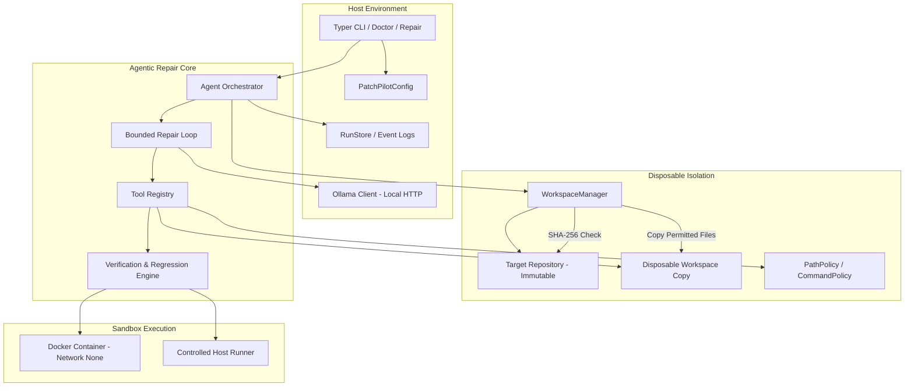

# PatchPilot — Architectural Specification

## System Overview

PatchPilot is an engineering-grade, self-healing AI coding agent operating locally via Ollama. It addresses software defects by systematically isolating target repositories, executing controlled test suites, and applying bounded repair loops.

## Module Boundaries

1. **`patchpilot.config`:**
   Provides typed configuration backed by Pydantic. Loads `.toml` files and environment variables (`PATCHPILOT_*`), with environment variables having precedence.
2. **`patchpilot.ollama_client`:**
   Manages HTTP communication with the local Ollama daemon (`http://localhost:11434`). Handles model queries, structured chat calls, and extracts native tool calls.
3. **`patchpilot.safety`:**
   Centralizes security boundaries:
   - `paths.py`: Path sanitization, boundary checking, symlink inspection, and secret detection.
   - `commands.py`: Sanitizes test arguments and blocks arbitrary command execution.
   - `redaction.py`: Masks passwords, tokens, and private keys.
   - `limits.py`: Enforces agent step and tool invocation budgets.
4. **`patchpilot.workspace`:**
   Guarantees source repository immutability:
   - `manifest.py`: Computes SHA-256 manifests across repositories.
   - `manager.py`: Copies permitted files to disposable workspaces and verifies source hash invariance.
   - `diff.py`: Computes clean unified diffs.
5. **`patchpilot.tools`:**
   Implements registered agent actions: `inspect_repository`, `search_code`, `read_file`, `edit_file`, and `run_tests`.
6. **`patchpilot.verification`:**
   Executes predefined test suites in sandboxes and evaluates regression states against pre-repair baselines.
7. **`patchpilot.agent`:**
   Contains prompt templates, conversation context window builder, and the bounded self-healing repair loop.
8. **`patchpilot.storage`:**
   Maintains append-only JSONL operational logs and structured JSON run reports with unified diff artifacts.
9. **`patchpilot.evaluation`:**
   Provides deterministic benchmark harnesses and performance metric tracking.
